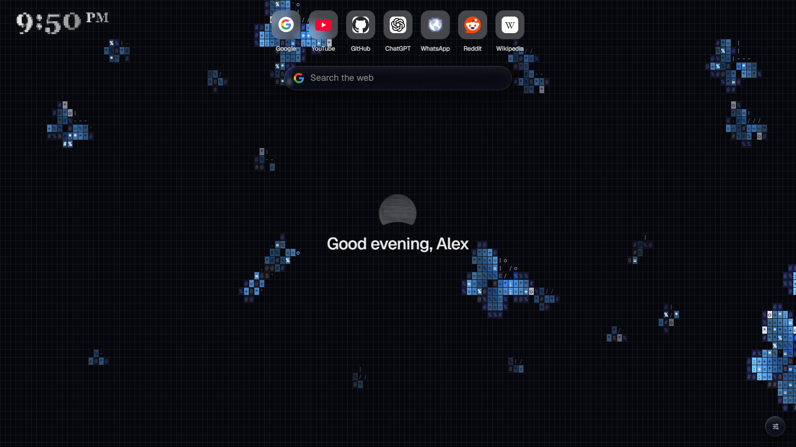
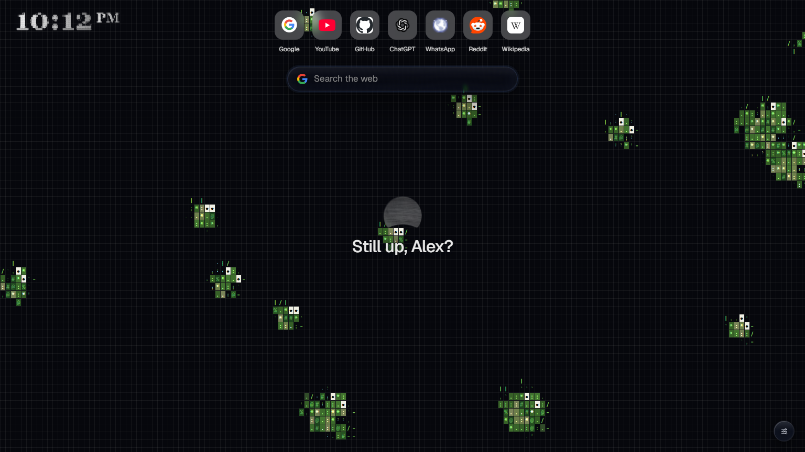
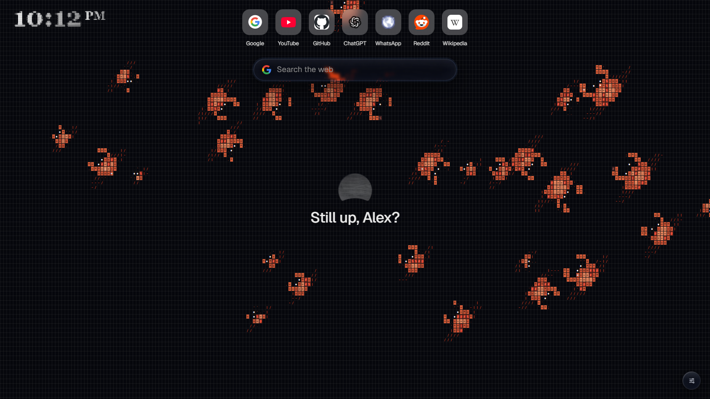
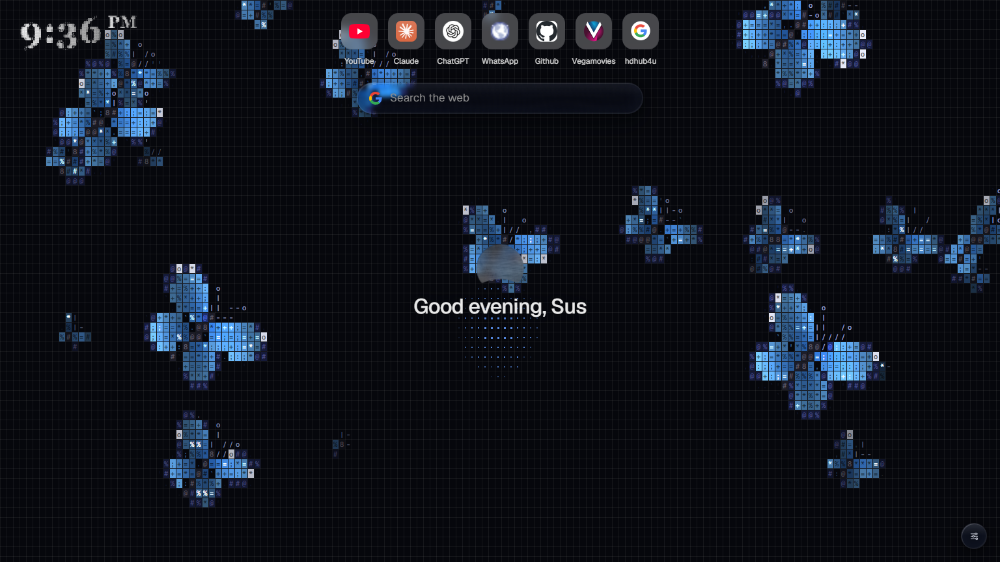
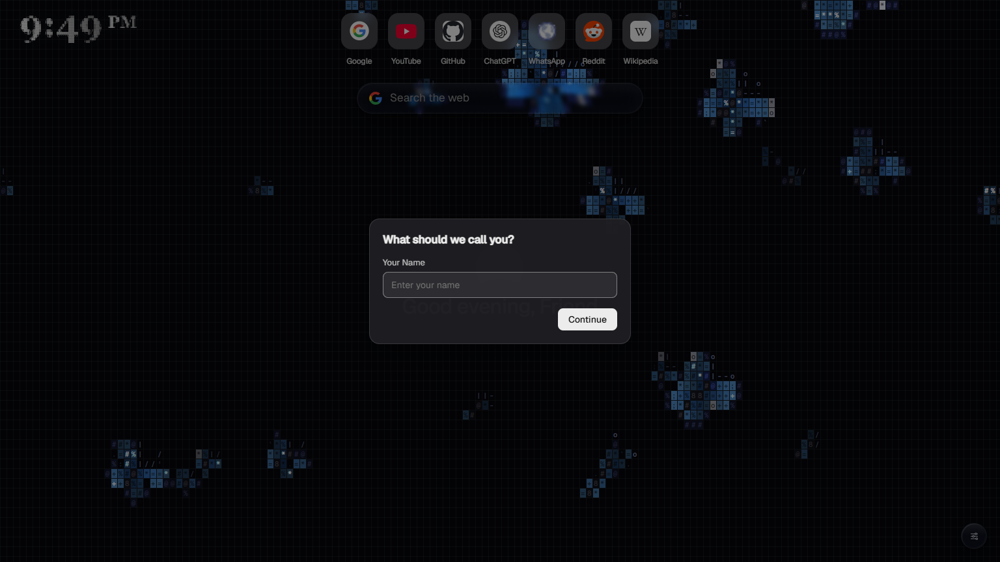
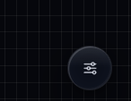
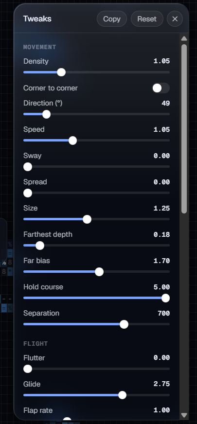

# ASCII Animals — New Tab (Browser Extension)

> ASCII animals as your new tab page — butterflies, koi, jellyfish, dragonflies, frogs, cranes, and crabs, featuring a personalized time-of-day greeting, interactive click ripples, automatic browser shortcuts, and a liquid-glass search bar.>

**Live demo: [ascii-animals-extension.antideploy.app](https://ascii-animals-extension.antideploy.app)

---

## ✨ Features

- **Dynamic Interactive Animals:** 7 beautiful animated ASCII creatures with realistic physics, wing flapping, and behavioral AI (Butterflies, Koi, Jellyfish, Dragonflies, Frogs, Cranes, Crabs).
- **Multiple Creature Modes:** Switch between different animals anytime using the Tweaks panel.
- **Personalized Greeting:** Prompts for your name on first install (`Good morning, [Name]`), saved locally in your browser. Click on your name anytime to edit or change it.
- **Auto Browser Shortcuts:** Automatically fetches and displays your browser's top visited sites (`topSites`). Right-click any shortcut to **Edit** (custom name/URL) or **Remove** it.
- **Search and Layout Customization:** Choose Google, Bing, DuckDuckGo, Brave, or Ecosia, and position the search bar and shortcuts at their default, top, center, or bottom positions.
- **Multi-Browser Auto-Detect:** Automatically displays the native browser mark for **Brave**, **Google Chrome**, or **Microsoft Edge** with zero external image files; Firefox uses the extension icon.
- **Compact ASCII Clock:** Character-grid clock featuring 12-hour time, AM/PM, and subtle ambient glow.
- **Liquid Glass Search Bar:** Minimalist search pill powered by Google search.
- **Interactive Ripples:** Click anywhere on the canvas to startle the creatures and watch water ripples smoothly dissipate into a clean, dark grid.
- **Tweaks Control Panel:** Click the settings icon at the bottom-right corner to customize animal types, counts, speeds, movement, and visual themes.

---

## 📸 Screenshots & Animal Showcase

### 🐾 Creature Varieties

| 🦋 Butterflies | 🐸 Frogs |
| :---: | :---: |
|  |  |

| 🦀 Crabs | 🌊 Interactive Click Ripple |
| :---: | :---: |
|  |  |

### ⚙️ First-Time Setup

### 🎛️ Tweaks Panel

The **Tweaks** button sits at the bottom-right corner of the page. Click it to reveal the hidden panel, where you can switch animals, choose a search engine, reposition the search bar and shortcuts, and fine-tune movement and flight settings (density, direction, speed, size, flutter, glide and more). Right-click a shortcut to edit it or remove it completely; removed shortcuts stay hidden across reloads.

---

## 🚀 Installation (Firefox and Firefox-based browsers)

### Firefox

1. Download `ascii-animals-extension-v2.2.zip` from the [latest GitHub release](https://github.com/GG-FLIPPER/ascii-animal-extension-for-firefox/releases/latest).
2. Extract the ZIP to a folder on your computer.
3. Open `about:debugging#/runtime/this-firefox`.
4. Click **Load Temporary Add-on...**, open the extracted folder, and select `manifest.json`.
5. Open a new tab (`Ctrl + T`) — enter your name and enjoy.

### LibreWolf and other Gecko-based browsers

Use the same extracted ZIP and `manifest.json` steps above. In LibreWolf, open `about:debugging`, select **This LibreWolf** (or the equivalent current-browser section), and choose **Load Temporary Add-on...**. Other Firefox-based browsers generally provide the same `about:debugging` workflow, although the page name or menu labels may differ.

Temporary add-ons are session-scoped: Firefox, LibreWolf, and other Gecko browsers remove them when the browser closes. For a persistent installation, use a signed release from [addons.mozilla.org](https://addons.mozilla.org/) or your browser's supported signed-extension store. Do not select the ZIP itself; select the extracted `manifest.json` file.

The Firefox build targets Firefox 140 or newer on desktop (and Firefox 142 or newer on Android) because it declares Firefox's built-in data-collection consent metadata. The `.xpi` download is the same package with an XPI filename:

- **Standard Firefox:** **Install Add-on from File** still requires a Mozilla-signed add-on. The `.xpi` extension does not bypass signing.
- **LibreWolf and other Gecko browsers:** unsigned XPIs may be installable if the browser's signing policy or preferences allow them; otherwise use temporary loading or a signed package.
- **Developer Edition/Nightly:** unsigned add-ons can be installed only when signing checks are explicitly disabled, such as with the supported development setting for `xpinstall.signatures.required`. Do not disable signing checks in a normal browsing profile.

### Chromium browsers

For Brave, Chrome, and Edge, download and extract the ZIP, open the browser's extensions page (`brave://extensions`, `chrome://extensions`, or `edge://extensions`), enable **Developer mode**, and click **Load unpacked** to select the extracted folder.

---

## 🛠️ Tech Stack & Credits

- Built with HTML5 Canvas, modern ES Modules, and vanilla CSS.
- Forked & redesigned from Stephen's [ascii-animals](https://github.com/DesignerStephen1/ascii-animals.git) (MIT License, Copyright (c) 2026 drewdi).
- ASCII clock inspired by pursurer's `AsciiMark` (MIT License, Copyright (c) 2026 pursurer).

---

## ⬇️ Downloads

- **Stable releases:** [GitHub Releases](https://github.com/sushilbyte7/ascii-animals-extension/releases) — download the latest `ascii-animals-extension-vX.Y.zip`, unzip it, and load it unpacked (see Installation above).

---

## 📄 License

This project is licensed under the Apache License 2.0 — see [LICENSE](LICENSE) for details.

Parts of the code come from other MIT-licensed projects and keep their MIT license: Stephen's ascii-animals ([LICENSE-MIT](LICENSE-MIT)) and pursurer's AsciiMark ([LICENSE-pond](LICENSE-pond)).
